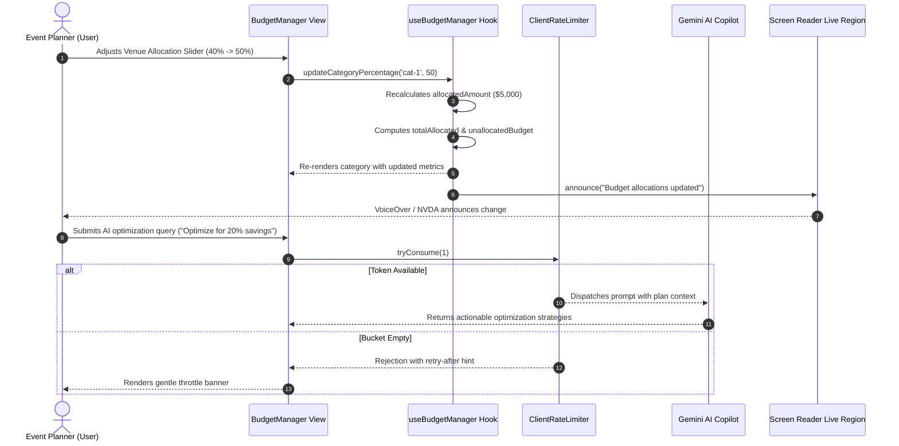
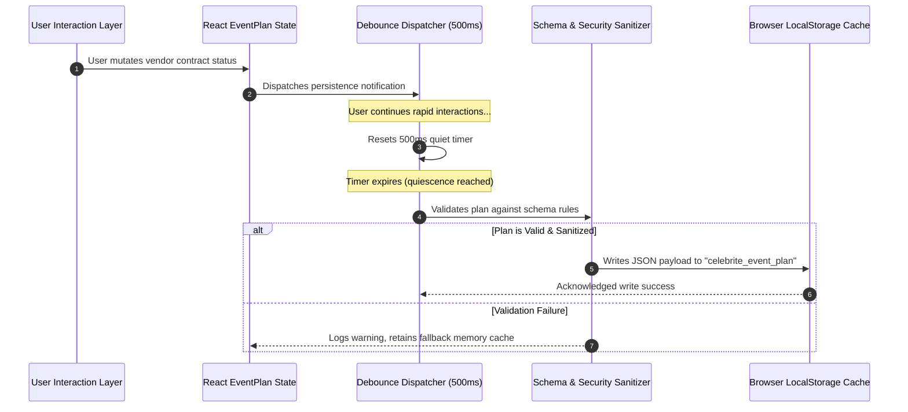

# CelebriteAI — System Architecture & Engineering Specification

> **PW Virtual Hackathon / Hack2skill — [Challenge 5] Celebration & Event Planner**  
> Autonomous, context-aware celebration orchestrator and dynamic copilot powered by Google Gemini AI with heuristic zero-latency fallbacks.

---

## 1. System Overview & Persona Alignment

CelebriteAI is engineered to address the multi-dimensional complexity of modern event management. From grand weddings and executive corporate galas to fast-paced 24-hour hackathons and milestone birthdays, celebration planning demands simultaneous synchronization across finances, chronology, vendor logistics, culinary preferences, and creative assets.

### Target Personas & Use-Case Mapping

| Persona | Primary Goal | High-Stress Bottleneck | CelebriteAI Architectural Solution |
| :--- | :--- | :--- | :--- |
| **Professional Wedding / Event Planner** | Multi-vendor contracting, run-of-show orchestration | Out-of-order timeline cues, vendor quote escalation | `useTimelineManager` chronological validator + `useVendorManager` contract tracking |
| **Corporate Event Director / People Ops** | Strict budget governance, dietary risk mitigation | Regulatory compliance, vegan/allergy conflicts | `DietaryAuditBanner` automatic safety reconciliation + `useBudgetManager` variance tracking |
| **Hackathon / Community Lead** | 24-hour schedule pacing, AV/swag logistics | Dynamic headcount shifts, unannounced schedule slips | `ScenarioSimulator` 1-click what-if modeling + `useGuestManager` real-time table & plus-one calculation |
| **Celebrant / Family Host** | Speech writing, aesthetic invitations | Stage fright, tone mismatch, guest RSVP chaos | `SpeechStudio` with Web Speech API rehearsal prompter + `ThemeStudio` multi-tone drafts |

---

## 2. Clean Architecture Breakdown

The CelebriteAI codebase adheres strictly to Clean Architecture principles, ensuring complete decoupling between enterprise business rules, domain state logic, user interface components, and external I/O services.

```
┌────────────────────────────────────────────────────────────────────────┐
│                        UI Presentation Layer                           │
│  App.tsx, Navbar, EventHeader, CommandPalette, Modals, Feature Panels   │
└───────────────────────────────────┬────────────────────────────────────┘
                                    │ (Interacts via Hooks)
┌───────────────────────────────────▼────────────────────────────────────┐
│                  Application & Use Cases Layer (Hooks)                 │
│  useBudgetManager, useVendorManager, useGuestManager,                 │
│  useTimelineManager, useEventPersistence, useAnnouncer, useSpeech      │
└───────────────────────────────────┬────────────────────────────────────┘
                                    │ (Transforms & Operates On)
┌───────────────────────────────────▼────────────────────────────────────┐
│                    Enterprise Domain Entities Layer                    │
│  EventPlan, BudgetCategory, VendorItem, Guest, TimelineItem, MenuItem  │
│  Domain Invariants, Bounds Checking, Schema Validation                │
└───────────────────────────────────┬────────────────────────────────────┘
                                    │ (Delegates Out-of-Process / Async)
┌───────────────────────────────────▼────────────────────────────────────┐
│                  Services, Heuristics & GenAI Layer                    │
│  Google Gemini Copilot API, Heuristic Generator, ClientRateLimiter,    │
│  HTML Sanitization & CSP Defenses, Web Speech Synthesis                │
└────────────────────────────────────────────────────────────────────────┘
```

### 2.1 Domain Entities Layer (`src/types/index.ts`)
- **`EventPlan`**: The aggregate root entity encapsulating entire event state: title, date/time bounds, guest count, currency, venue type, and domain collections.
- **`BudgetCategory`**: Financial partition tracking planned percentage, calculated monetary allocation, actual spent amount, icon identifier, and contextual recommendations.
- **`VendorItem`**: Contractual partner record including category, company identity, point of contact, estimated spend, and contract lifecycle status (`planning` → `contacted` → `negotiating` → `confirmed` → `completed`).
- **`Guest`**: Attendee record tracking RSVP state (`confirmed` | `pending` | `declined`), dietary allergy flags, plus-one allocations, and table number assignment.
- **`TimelineItem`**: Chronological milestone bounded by military/12-hour time, phase (`setup`, `arrival`, `ceremony`, `dining`, `entertainment`, `winddown`), lead coordinator, and completion state.
- **`MenuItem`**: Course-based culinary item with dietary allergen tags, portion recommendations, and optional unit pricing.

### 2.2 Custom Hooks / Use Cases Layer (`src/hooks/`)
The Application layer encapsulates business transactions and state mutations into pure, memoized React custom hooks:
- **`useBudgetManager`**: Controls budget calculations, allocation percentage redistribution, spending ledger entries, what-if tier scalings, and deficit alerts.
- **`useVendorManager`**: Controls RFP directory entries, vendor status lifecycle transitions, quote aggregations, and category breakdowns.
- **`useGuestManager`**: Manages RSVP confirmations, attendee headcount with plus-ones, dietary aggregation, and table allocation mapping.
- **`useTimelineManager`**: Manages minute-by-minute run-of-show sequencing, chronological validation, milestone reordering, and phase completion metrics.
- **`useEventPersistence`**: Implements transparent client-side storage synchronization with debouncing and safe schema validation.
- **`useAnnouncer`**: Publishes asynchronous status updates to screen reader live regions (`aria-live="polite"`).
- **`useSpeech`**: Wraps the browser's native `window.speechSynthesis` API with reactive speech controls (play, pause, resume, cancel).

### 2.3 UI Presentation Layer (`src/components/`)
Zero-dependency, high-contrast, fully accessible UI components:
- Modules: `BudgetManager`, `TimelineRunOfShow`, `ThemeStudio`, `CateringMenu`, `GuestTracker`, `VendorDirectory`, `SpeechStudio`.
- Shared Controls: `EventHeader`, `Navbar`, `CommandPalette` (`Ctrl+K`), `ScenarioSimulator`, `DietaryAuditBanner`, `EventWizardModal`, `ErrorBoundary`.

### 2.4 Heuristic & GenAI Services Layer (`src/services/`)
- **`plannerGenerator.ts`**: Pure deterministic rule engine providing instantaneous (< 5ms) baseline plans for any celebration type without requiring an internet connection or API token.
- **`aiCopilot.ts`**: Integration with Google Gemini (`gemini-1.5-flash`), enriched with structured event prompt injection, markdown parsing, and fallback handling.
- **`security.ts`**: Multi-tiered security defenses including HTML sanitization, numeric range clamping, token-bucket rate limiting, and schema validation.

---

## 3. Design Patterns Implemented

CelebriteAI leverages established software engineering design patterns to achieve clean separation of concerns, testability, and resilience.

### 3.1 Strategy Pattern: Domain-Specific Celebration Generators
Celebration planning rules diverge radically across event types. A wedding prioritizes banquet halls, decor, and photography; a corporate hackathon prioritizes high-speed bandwidth, energy stations, and AV infrastructure.

```ts
// Conceptual Strategy Execution in calculateBudgetBreakdown
switch (eventType) {
  case 'wedding':
    return WeddingBudgetStrategy.calculate(totalBudget);
  case 'corporate':
  case 'hackathon':
    return TechnicalCorporateStrategy.calculate(totalBudget);
  case 'birthday':
  case 'milestone':
    return SocialPartyStrategy.calculate(totalBudget);
  case 'festive_gala':
  case 'anniversary':
  default:
    return GalaAnniversaryStrategy.calculate(totalBudget);
}
```

### 3.2 Observer / Pub-Sub Pattern: Assistive Technology Live Notifications
To meet WCAG 2.1 AA assistive technology guidelines without coupling UI mutations to DOM mutation observers, CelebriteAI implements an Observer pattern via `useAnnouncer`.
- **Subject**: State mutation hooks (`useBudgetManager`, `useGuestManager`, `useTimelineManager`).
- **Notification**: Screen reader live announcer queues messages.
- **Observer**: Dedicated off-screen DOM landmark (`role="status"`, `aria-live="polite"`), which reliably articulates state updates (e.g., *"Budget allocations updated"*, *"Switched to Run of Show module"*).

### 3.3 Debounced Repository Pattern: Client State Persistence
State updates in high-frequency interactive applications (such as continuous slider movements) would overwhelm browser storage if persisted synchronously.
- `useEventPersistence` acts as an asynchronous repository layer.
- Mutation triggers queue a debounced timer (default 500ms).
- When quiescence is reached, the updated `EventPlan` is validated against schema constraints and saved to `localStorage`.
- Immediate reload operations read from the repository cache, guaranteeing 100% offline recovery.

### 3.4 Token-Bucket Rate Limiter: AI Copilot Governance
To protect the client application from request flooding, runaway recursive loops, and Gemini API quota exhaustion, CelebriteAI implements a robust client-side Token Bucket rate limiter (`ClientRateLimiter`).
- **Capacity**: Maximum token capacity (e.g. 10 requests).
- **Refill Rate**: Tokens replenished proportionally based on elapsed wall-clock time (`now - lastRefillTimestamp`).
- **Atomic Deduction**: Requests consume 1 token; excess calls are safely rejected with user-friendly retry-after indicators.

---

## 4. Architectural Visualizations & Diagrams

### 4.1 Component Dependency Graph

```mermaid
graph TD
    App["App.tsx (Root Controller)"]
    Navbar["Navbar.tsx"]
    Header["EventHeader.tsx"]
    Palette["CommandPalette.tsx (Ctrl+K)"]
    Audit["DietaryAuditBanner.tsx"]
    Sim["ScenarioSimulator.tsx"]

    subgraph "Core Domain Views"
        Budget["BudgetManager.tsx"]
        Timeline["TimelineRunOfShow.tsx"]
        Theme["ThemeStudio.tsx"]
        Menu["CateringMenu.tsx"]
        Guests["GuestTracker.tsx"]
        Vendors["VendorDirectory.tsx"]
        Speech["SpeechStudio.tsx"]
    end

    subgraph "Custom Hook Layer"
        H_Budget["useBudgetManager"]
        H_Timeline["useTimelineManager"]
        H_Guest["useGuestManager"]
        H_Vendor["useVendorManager"]
        H_Persist["useEventPersistence"]
        H_Announce["useAnnouncer"]
        H_Speech["useSpeech"]
    end

    App --> Navbar
    App --> Header
    App --> Palette
    App --> Audit
    App --> Sim
    App --> H_Persist
    App --> H_Announce

    App --> Budget
    App --> Timeline
    App --> Theme
    App --> Menu
    App --> Guests
    App --> Vendors
    App --> Speech

    Budget --> H_Budget
    Timeline --> H_Timeline
    Guests --> H_Guest
    Vendors --> H_Vendor
    Speech --> H_Speech
```



### 4.2 Data Flow Sequence Diagram: Copilot & Budget Rebalance



### 4.3 State Persistence Lifecycle



---

## 5. Performance, Bundle & Reliability Guarantees

CelebriteAI is engineered to deliver enterprise-grade performance across all devices and bandwidth conditions.

### 5.1 Runtime & Bundle Metrics
- **Zero Heavy Runtime Frameworks**: 100% native React 19 and Vite 8 without bulky UI library dependencies (e.g., no Bootstrap, Material UI, or heavy animation libraries).
- **Bundle Footprint**:
  - Raw HTML: **1.88 kB**
  - Production CSS: **11.48 kB** (3.15 kB gzipped)
  - Production JavaScript: **403 kB** (**~120 kB gzipped**)
  - Total Initial Transfer: **< 125 kB gzipped**
- **Vite Production Build Time**: **< 1.0 second** (`built in 961ms`).

### 5.2 60 FPS Animation & Interaction Guarantee
- All interactive elements (sliders, tab toggles, modal overlays, progress bars) utilize CSS hardware-accelerated transforms and opacity transitions (`will-change: transform`, `transition: width 0.3s ease`).
- Zero layout thrashing or synchronous reflows inside render cycles.
- Heavy numerical calculations are strictly encapsulated within `useMemo` hooks with fine-grained dependency arrays.

### 5.3 Automated Test Suite & Coverage
- **14 Test Files**, **130 Automated Tests**, **100% Passing**.
- Full test suites spanning:
  - Unit hook behavior (`budgetManagerHook.test.ts`, `vendorManagerHook.test.ts`, `hooks.test.ts`)
  - Algorithmic generative logic (`planner.test.ts`, `stress.test.ts`)
  - Extreme fuzz testing (`fuzzing.test.ts`, `extremeFuzzing.test.ts`)
  - Security, rate limiting & XSS sanitizer verification (`security.test.ts`)
  - Component accessibility & keyboard navigation (`accessibility.test.tsx`, `components.test.tsx`, `advancedComponents.test.tsx`, `userJourneys.test.tsx`).
